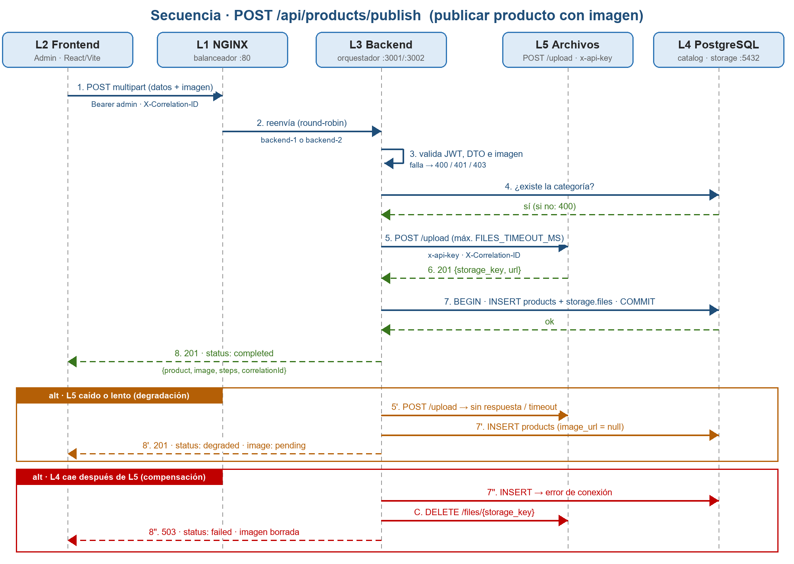

# Orquestación: publicar producto con imagen (Proyecto de Aula 3.3)

**Autor del aporte:** Yeiker Lopez (L2 – Frontend) · rama `feature/orquestacion-yeiker-lopez`

## 1. Necesidad funcional

El administrador publica un producto **con su foto**. La operación necesita dos capacidades de nodos distintos:

| Capacidad | Nodo | Qué hace |
|---|---|---|
| Almacenamiento de archivos | **L5** servidor de archivos | Guarda la imagen y devuelve su clave y URL |
| Persistencia del catálogo | **L4** PostgreSQL | Guarda el producto (`catalog.products`) y los metadatos del archivo (`storage.files`) |

Antes, el **navegador** coordinaba dos peticiones (`POST /products` y luego `POST /products/:id/image`). Si la segunda fallaba, el producto quedaba a medias y nadie registraba qué había pasado. Ahora **L3 orquesta** las dos capacidades en una sola operación, `POST /api/products/publish`. Para L2 hay una sola llamada y un resultado claro.

Intervienen: **L2** (pantalla Administración), **L1** (NGINX, entrada y balanceo), **L3** (backend NestJS ×2, orquestador), **L5** y **L4**.

## 2. Secuencia y estados



| Paso | Nodo | Acción | Si falla |
|---|---|---|---|
| 1 | L3 | Valida JWT de admin, datos (DTO) e imagen (JPG/PNG/WEBP ≤ 5 MB) | 401 / 403 / 400, no se toca L4 ni L5 |
| 2 | L4 | Comprueba que la categoría exista (si se envió) | 400 si no existe · 503 si L4 no responde |
| 3 | L5 | `POST /upload` con `x-api-key` y `X-Correlation-ID`, espera máx. `FILES_TIMEOUT_MS` | **Degradación**: se sigue sin imagen |
| 4 | L4 | Transacción: `INSERT` producto + `INSERT` metadatos del archivo | **Compensación**: `DELETE` de la imagen en L5 y 503 |
| 5 | L3 | Responde el resultado compuesto | — |

Estado final de la operación (`status`):

| status | HTTP | Producto | Imagen (`image.status`) |
|---|---|---|---|
| `completed` | 201 | publicado | `stored` (o `none` si no se envió) |
| `degraded` | 201 | publicado con la imagen por defecto | `pending` + `reason` (se puede reintentar) |
| `failed` | 503 | no se publicó | borrada de L5 si había llegado (compensación) |

## 3. Contrato

**`POST /api/products/publish`** 👑 admin · `multipart/form-data`

| Campo | Tipo | Obligatorio |
|---|---|---|
| `name` | texto (máx. 120) | sí |
| `price` | número ≥ 0, 2 decimales | sí |
| `stock` | entero ≥ 0 | sí |
| `description` | texto | no |
| `categoryId` | entero | no |
| `file` | imagen JPG/PNG/WEBP ≤ 5 MB | no |

Cabecera opcional `X-Correlation-ID` (si falta o no es válida, L3 genera un UUID). Siempre vuelve en la respuesta.

```json
// 201 Created
{
  "status": "completed",
  "correlationId": "publicar-webcam-001",
  "product": { "id": 2, "name": "Webcam Full HD", "price": 45.9, "stock": 12, "imageUrl": "/files/fbea26c9-….png", "categoryId": 1 },
  "image": { "status": "stored", "url": "/files/fbea26c9-….png" },
  "steps": [
    { "node": "L4", "step": "Validar categoría", "result": "ok", "ms": 35 },
    { "node": "L5", "step": "Guardar imagen", "result": "ok", "ms": 25 },
    { "node": "L4", "step": "Guardar producto y metadatos", "result": "ok", "ms": 74 }
  ]
}
```

## 4. Rutas, puertos y dependencias

| Origen → destino | Ruta | Puerto | Dependencia / configuración |
|---|---|---|---|
| L2 → L1 | `POST /api/products/publish` | 80 (NGINX) | `VITE_BASE_URL` vacía (rutas relativas) |
| L1 → L3 | `/api/` → `upstream backend` | 3001 y 3002 | `proxy_pass` sin barra final · `client_max_body_size 5M` |
| L3 → L5 | `POST {FILES_URL}/upload` · `DELETE {FILES_URL}/files/{clave}` | el de L5 | `FILES_MODE=remote`, `FILES_URL`, `FILES_API_KEY`, `FILES_TIMEOUT_MS`, `FILES_DELETE_PATH` |
| L3 → L4 | `catalog.products`, `storage.files` | 5432 | `DB_HOST`, `DB_PORT`, `DB_USER`, `DB_PASSWORD`, `DB_NAME` |
| Navegador → L1 → L5 | `GET /files/{clave}` | 80 | L1 enruta `/files/` hacia L5 |

Dependencias del flujo: **L4 es obligatoria** (sin ella no se publica nada). **L5 es opcional** para publicar, porque si falla el flujo se degrada. `GET /api/health` lo refleja: `status: "degraded"` con `files: "down"`.

## 5. Pasos de implementación

1. **L3 · correlación**: `src/common/correlation-id.ts`. El middleware conserva o genera `X-Correlation-ID`, lo devuelve en la respuesta y el decorador `@CorrelationId()` lo entrega al controlador. Se registra en `main.ts`.
2. **L3 · archivos**: `FilesService` separa `store()` (solo L5, reenvía `X-Correlation-ID`), `createRecord()` (metadatos para la transacción) y `remove()` (compensación). El tiempo máximo hacia L5 se configura con `FILES_TIMEOUT_MS`.
3. **L3 · orquestador**: `src/products/product-publisher.service.ts` implementa la secuencia de la sección 2 y registra cada paso con el `correlation_id`.
4. **L3 · endpoint**: `POST /products/publish` en `ProductsController`, con `PublishProductDto` (convierte los números que llegan como texto en multipart).
5. **L2 · frontend**:
   - `productsApi.publish()` envía datos e imagen en una petición con su `X-Correlation-ID`, generado en `utils/correlation.js`.
   - `AdminProductos` publica los productos nuevos por el orquestador.
   - `PublishFlow` muestra el estado, los pasos y la correlación.
   - En `degraded`, el botón **Reintentar la imagen** la vuelve a enviar sin tener que elegirla otra vez.
6. **Configuración** (`backend/.env` de cada instancia): `FILES_MODE=remote`, `FILES_URL=http://<IP de L5>`, `FILES_API_KEY=<clave de L5>`, `FILES_TIMEOUT_MS=10000`. Las dos instancias deben tener los mismos valores.
7. **Pruebas**: `cd backend && npx vitest run` ejecuta 5 pruebas del orquestador. Para el entorno local completo, ver [pruebas-locales/README.md](pruebas-locales/README.md).

## 6. Pruebas realizadas (entorno local con la misma topología)

| Escenario | Resultado |
|---|---|
| Todo disponible | `201 completed`; la imagen se ve por L1 (`/files/...`); el mismo `X-Correlation-ID` aparece en los logs de L1, L3 y L5 |
| L5 apagado | `201 degraded`, `image.status: pending`; producto en el catálogo sin imagen; `/health` → `files: down` |
| L5 lento (8 s, límite 5 s) | `201 degraded` a los 5 s, sin esperar a L5 |
| L4 apagado | `503 failed`; L5 recibió la imagen y L3 la borró (`DELETE 200`): no quedan archivos huérfanos |
| Datos inválidos / categoría inexistente / sin token | `400` / `400` / `401`, sin llamadas a L5 |

## 7. Pendiente con el equipo

- **L5** debe aceptar `DELETE /files/{clave}` con `x-api-key` para la compensación. Si no lo acepta, L3 deja en el log la clave del archivo huérfano.
- Si L5 recibe la imagen pero tarda más que `FILES_TIMEOUT_MS`, el producto queda `degraded` y L5 podría quedarse con ese archivo. Conviene una limpieza periódica de archivos sin fila en `storage.files`.
