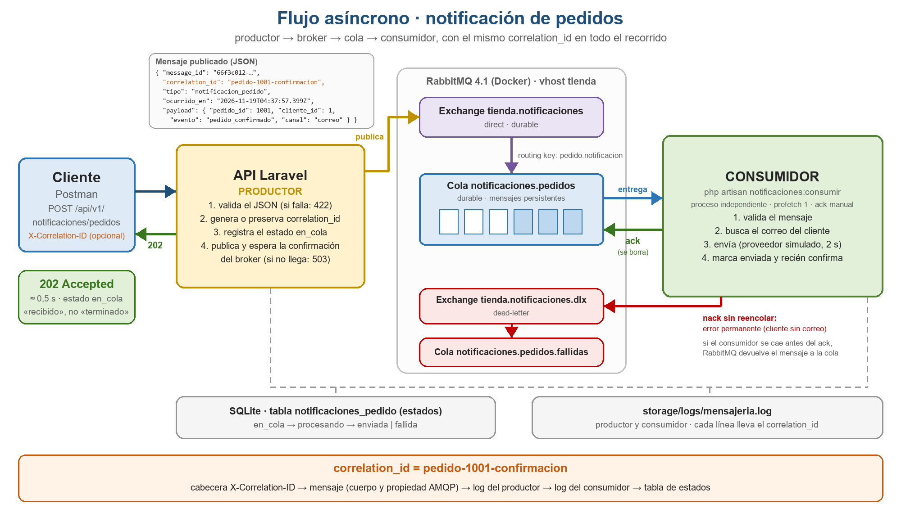

# Práctica 3.1 – Infraestructura de comunicación asíncrona

**Estudiante:** Yeiker Lopez · IS-803 Integración e Implementación de Software · 8vo "A" · ULEAM
**Rama:** `practica-asincrona-yeiker-lopez` (trabajo individual dentro del proyecto de aula)

Proceso del proyecto de aula (tienda en línea de 5 nodos): **notificar al cliente cuando cambia el estado de su pedido**
(`pedido_confirmado`, `pedido_enviado`, `pedido_entregado`). Enviar el correo puede tardar varios segundos y el cliente
no necesita esperarlo: la API recibe la solicitud, la deja en una cola y un consumidor la procesa después.



## Componentes

| Componente | Implementación |
|---|---|
| Productor | API Laravel `POST /api/v1/notificaciones/pedidos`: valida el JSON, genera o preserva el `correlation_id`, registra el estado `en_cola`, publica y espera la confirmación del broker. Responde **202 Accepted**. |
| Broker | RabbitMQ 4.1 en Docker ([docker-compose.yml](docker-compose.yml)), vhost `tienda`, solo en `127.0.0.1`. |
| Exchange y cola | `tienda.notificaciones` (direct, durable) → routing key `pedido.notificacion` → cola **`notificaciones.pedidos`** (durable, mensajes persistentes). |
| Cola de fallidas | `tienda.notificaciones.dlx` → `notificaciones.pedidos.fallidas` (dead-letter). |
| Consumidor | `php artisan notificaciones:consumir`: proceso independiente, `prefetch 1`, **ack manual** después de procesar. |
| Estado final | Tabla `notificaciones_pedido`: `en_cola → procesando → enviada \| fallida`. |
| Versión síncrona (comparación) | `POST /api/v1/notificaciones/pedidos/sincrono`: hace el mismo trabajo dentro de la petición y responde **200** al terminar. |

El envío de correo está **simulado**: el consumidor espera `NOTIF_TIEMPO_ENVIO_MS` (2000 ms) como si llamara a un proveedor externo. No se envían correos reales.

## Mensaje

```json
{
  "message_id": "66f3c012-d13e-459c-a8f0-dfb2f18c402a",
  "correlation_id": "pedido-1001-confirmacion",
  "tipo": "notificacion_pedido",
  "ocurrido_en": "2026-11-19T04:37:57.399Z",
  "payload": { "pedido_id": 1001, "cliente_id": 1, "evento": "pedido_confirmado", "canal": "correo" }
}
```

- `message_id` (UUID): identifica **este mensaje**. El consumidor lo usa para no enviar dos veces la misma notificación si RabbitMQ lo entrega de nuevo.
- `correlation_id`: identifica **la operación completa**. Llega en la cabecera `X-Correlation-ID` (si es válido se conserva; si no, la API genera un UUID) y aparece en la respuesta HTTP, en el cuerpo y en las propiedades AMQP del mensaje, en cada línea del log del productor y del consumidor, y en la tabla de estados.
- El mensaje **no lleva el correo ni el nombre** del cliente: el consumidor los busca al procesar. En la tabla y en el log el correo queda enmascarado (`an***@tienda.test`).

## Ack y errores

| Situación | Qué hace el consumidor | Resultado |
|---|---|---|
| Procesado correctamente | `ack` | RabbitMQ borra el mensaje; estado `enviada`. |
| Mensaje duplicado (ya `enviada`) | `ack` sin repetir el envío | Idempotencia por `message_id`. |
| Error permanente (cliente sin correo, mensaje que no cumple el contrato, pedido inexistente) | `nack` sin reencolar | El mensaje pasa a `notificaciones.pedidos.fallidas`; estado `fallida` con el motivo. |
| Error transitorio (excepción inesperada) | `nack` con reencolado la primera vez; si vuelve a fallar, a fallidas | Un segundo intento automático. |
| El consumidor se cierra antes del `ack` (Ctrl+C) | — | RabbitMQ devuelve el mensaje a la cola y lo entrega de nuevo (`reentregado: true`). |
| Broker apagado al publicar | (productor) | La API responde **503** `no_publicada`: no afirma que quedó en cola. |

## Requisitos

- PHP 8.2 con las extensiones `sockets` y `pdo_sqlite` (en XAMPP: quitar el `;` de `extension=sockets` en `php.ini`).
- Composer, Docker Desktop y Postman.

## Ejecución

```bash
# 1. Configuración (una sola vez)
composer install
cp .env.example .env            # en .env, invente un usuario y una clave de prueba para RABBITMQ_USER y RABBITMQ_PASSWORD
php artisan key:generate
touch database/database.sqlite
php artisan migrate --seed       # clientes y pedidos ficticios: 1001, 1002, 1003 y 1004 (cliente sin correo)

# 2. Broker
docker compose up -d             # espere a que "docker compose ps" diga healthy
php artisan mensajeria:preparar  # crea exchange y colas, y muestra cuántos mensajes esperan

# 3. Terminal 1 – API (productor)
php artisan serve --host=127.0.0.1 --port=8000

# 4. Terminal 2 – consumidor
php artisan notificaciones:consumir
```

- Panel de RabbitMQ: <http://localhost:15672> (pestaña **Queues**: `notificaciones.pedidos` y `notificaciones.pedidos.fallidas`). También: `docker exec rabbitmq-practica-yeiker rabbitmqctl list_queues -p tienda name messages consumers`.
- Registro del flujo: `storage/logs/mensajeria.log`.
- Postman: importe [postman/Practica_Asincrona_Notificaciones.postman_collection.json](postman/Practica_Asincrona_Notificaciones.postman_collection.json) (12 peticiones con pruebas automáticas).

## Pruebas obligatorias de la guía

| Escenario | Cómo se prueba | Resultado obtenido |
|---|---|---|
| Mensaje válido | Peticiones 1, 2 y 3 de Postman | 202 `en_cola`; el consumidor hace `ack`; estado `enviada`. |
| Consumidor detenido | Ctrl+C en el consumidor → petición 6 → `mensajeria:preparar` → reiniciar consumidor | La API responde 202; la cola muestra 1 mensaje en espera y 0 consumidores; al reanudar se procesa y la cola vuelve a 0. |
| Mensaje inválido | Peticiones 8 y 9 | 422 con el detalle por campo; no se publica nada. |
| Correlación | Petición 11 y `storage/logs/mensajeria.log` | El mismo `correlation_id` en la respuesta, el mensaje, el log del productor, el log del consumidor y la tabla de estados. |

## Comparación síncrona / asíncrona (medido en este equipo)

| Criterio | Síncrono (`/sincrono`) | Asíncrono (cola) |
|---|---|---|
| Tiempo de respuesta inicial | ≈ 2,5 s (200 cuando el envío ya terminó) | ≈ 0,45 s (202 al quedar en cola) |
| Finalización del trabajo | La misma respuesta | El consumidor termina ≈ 2 s después (`demoraTotalMs`) |
| Dependencia del consumidor | No hay consumidor: la API hace todo | La API no lo necesita para responder |
| Ante indisponibilidad | Si el proveedor falla, el cliente recibe el error | Consumidor caído: el mensaje espera en la cola. Broker caído: 503 |
| Trazabilidad | Una sola petición | `correlation_id` en todos los pasos y tabla de estados |

Unos 0,35 s de cada respuesta son el arranque de Laravel en el servidor de desarrollo de PHP en Windows (lo mismo tarda `GET /up`). La diferencia entre las dos versiones (≈ 2 s) es el trabajo que el modo asíncrono saca de la petición.

## Pruebas automáticas

```bash
php artisan test   # 19 pruebas: productor (10), consumidor (6) e integración con el RabbitMQ real (3)
```

Las de integración usan colas propias `*.pruebas` y se omiten solas si el broker no está encendido.

## Seguridad

- `.env` no se sube (está en `.gitignore`); `.env.example` solo trae los nombres de las variables, con usuario y clave vacíos.
- `mensajeria:preparar` muestra host, puerto y vhost, pero nunca la clave.
- Los puertos del broker solo escuchan en `127.0.0.1`.
- Datos de prueba ficticios con el dominio `.test`.
