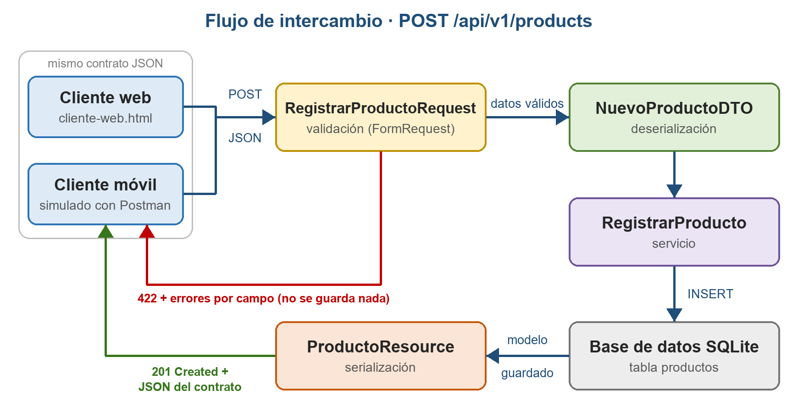
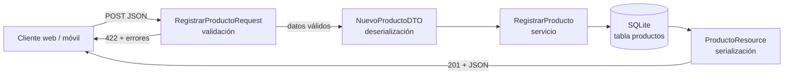

# Contrato JSON – Registrar un producto

**Estudiante:** Yeiker Lopez · **Asignatura:** IS-803 Integración e Implementación de Software · **Tema 2.2**

## 1. Proceso (Actividad 1)

| Elemento | Descripción |
|---|---|
| Proceso | Registrar un producto en el catálogo de la tienda |
| Actores | Administrador (desde el cliente web o la app móvil), API Laravel, base de datos |
| Endpoint | `POST /api/v1/products` (registro) · `GET /api/v1/products/{id}` (consulta) |
| El cliente envía | Nombre, descripción, precio, stock y categoría |
| El backend devuelve | El producto creado con su id, disponibilidad, categoría, imagen y fecha de creación |
| Cabeceras | `Content-Type: application/json` (cuerpo en UTF-8) · `Accept: application/json` (si falta, la API igual responde en JSON) |

Los nombres de los campos son los del contrato del proyecto de aula ([Plan_Frontend_Contrato_API.md](../Plan_Frontend_Contrato_API.md)): inglés y camelCase, porque así los consume el frontend React que ya existe. La base de datos usa nombres internos en español; la traducción entre ambos la hacen el DTO y el Resource (sección 6).

## 2. Contrato de solicitud (cliente → backend)

```json
{
  "name": "Parlante portátil",
  "description": "Resistente al agua, 12 h de batería",
  "price": 35.5,
  "stock": 20,
  "categoryId": 1
}
```

| Campo | Tipo | ¿Obligatorio? | Reglas | Significado |
|---|---|---|---|---|
| `name` | string | Sí | 3 a 120 caracteres, único en el catálogo | Nombre visible del producto |
| `description` | string / null | No | máx. 500 caracteres | Descripción para el cliente final |
| `price` | number | Sí | número JSON (no texto), mayor que 0, máx. 2 decimales | Precio unitario en dólares (USD), no en centavos |
| `stock` | integer | Sí | entero JSON (no texto), de 0 a 100000 | Unidades disponibles para la venta |
| `categoryId` | integer / null | No | entero JSON, debe existir | Categoría del producto; `null` = sin categoría |

- Se quitan los espacios al inicio y al final de los textos. Un texto vacío (`""`) se guarda como `null`.
- `description` y `categoryId` pueden omitirse, enviarse como `null` o (en `description`) como `""`: los tres casos significan "sin valor".
- `id`, `available`, `imageUrl` y `createdAt` los asigna el servidor. Si el cliente los envía, se ignoran.

## 3. Contrato de respuesta (backend → cliente)

`201 Created` al registrar (con cabecera `Location: /api/v1/products/{id}`) y `200 OK` al consultar. La consulta devuelve el mismo objeto `data`, sin `message`.

```json
{
  "data": {
    "id": 3,
    "name": "Parlante portátil",
    "description": "Resistente al agua, 12 h de batería",
    "price": 35.5,
    "stock": 20,
    "available": true,
    "categoryId": 1,
    "category": { "id": 1, "name": "Electrónica" },
    "imageUrl": null,
    "createdAt": "2026-11-15T15:30:00Z"
  },
  "message": "Producto registrado correctamente."
}
```

| Campo | Tipo | ¿Siempre presente? | Significado |
|---|---|---|---|
| `message` | string | Solo al registrar | Resultado legible de la operación |
| `data.id` | integer | Sí | Identificador único, generado por el servidor |
| `data.name` | string | Sí | Nombre del producto |
| `data.description` | string / null | Sí (puede ser `null`) | Descripción |
| `data.price` | number | Sí | Precio en USD. Es un número: el cliente decide cómo mostrarlo (p. ej. `$ 35.50`) |
| `data.stock` | integer | Sí | Unidades disponibles |
| `data.available` | boolean | Sí | `true` si `stock > 0`. Lo calcula el servidor |
| `data.categoryId` | integer / null | Sí (puede ser `null`) | Id de la categoría |
| `data.category` | object / null | Sí (puede ser `null`) | Categoría `{ id, name }`, para mostrarla sin otra petición |
| `data.imageUrl` | string / null | Sí (puede ser `null`) | Ruta relativa de la imagen (`/files/...`). Es `null` al registrar: la imagen se sube en otro proceso |
| `data.createdAt` | string (ISO 8601, UTC) | Sí | Fecha y hora de creación, en UTC (termina en `Z`) |

## 4. Respuestas de error

**422 – error de validación.** `message` resume el primer error; `errors` trae la lista de errores de cada campo.

```json
{
  "message": "El precio (price) debe ser un número JSON, no texto. Ejemplo: 35.5 (y 2 errores más)",
  "errors": {
    "price": ["El precio (price) debe ser un número JSON, no texto. Ejemplo: 35.5"],
    "stock": ["El stock debe ser un número entero JSON, no texto. Ejemplo: 20"],
    "categoryId": ["La categoría (categoryId) debe ser un número entero o null."]
  }
}
```

**404 – no existe** (solo en la consulta):

```json
{ "message": "El recurso solicitado no existe." }
```

En todos los casos el cliente lee el texto para el usuario en `message`, igual que en el resto del proyecto.

## 5. Códigos HTTP

| Código | Cuándo | Qué se guarda |
|---|---|---|
| `201 Created` | `POST` con datos válidos | El producto nuevo |
| `200 OK` | `GET` de un producto que existe | Nada |
| `422 Unprocessable Content` | Falta un campo obligatorio, un tipo o formato es incorrecto, la categoría no existe o el nombre ya está registrado | Nada |
| `404 Not Found` | `GET` de un id que no existe | Nada |

## 6. Correspondencia contrato ↔ base de datos

| Contrato (JSON) | Tabla `productos` |
|---|---|
| `id` | `id` |
| `name` | `nombre` |
| `description` | `descripcion` |
| `price` | `precio` (decimal 10,2) |
| `stock` | `stock` |
| `categoryId` | `categoria_id` |
| `category` | relación con `categorias` |
| `imageUrl` | `imagen_url` |
| `createdAt` | `created_at` |
| `available` | no se guarda: se calcula |

Si mañana cambia una columna, solo cambian el DTO y el Resource. El contrato, y con él los clientes web y móvil, sigue igual.

## 7. Serialización y deserialización

**En el servidor (Laravel):**

- **Deserialización.** Laravel convierte el texto JSON del cuerpo en un arreglo PHP. `RegistrarProductoRequest` comprueba campos, tipos y formatos. Con los datos válidos, `NuevoProductoDTO::desdeContrato()` crea un objeto tipado (`string`, `?string`, `float`, `int`, `?int`) con los nombres del dominio. El servicio `RegistrarProducto` solo trabaja con ese objeto.
- **Serialización.** `ProductoResource` convierte el modelo guardado en el arreglo del contrato: renombra campos, convierte `precio` (que Eloquent entrega como texto `"35.50"`) en número, calcula `available` y da formato ISO 8601 en UTC a la fecha. Laravel lo convierte en JSON.

**En el cliente** ([public/cliente-web.html](public/cliente-web.html)):

- Los campos de un formulario HTML siempre entregan texto. Antes de enviar, el cliente convierte cada valor al tipo del contrato (`Number(...)`, `""` → `null`) y arma el JSON con `JSON.stringify`.
- Al recibir la respuesta, `res.json()` la convierte de nuevo en un objeto, y el cliente usa los campos tal como los define el contrato (`price.toFixed(2)`, `category.name`, `new Date(createdAt)`).

## 8. Diagrama



Versión en texto (Mermaid):



## 9. Campos que se interpretarían distinto sin este contrato (Actividad 4)

| Campo | Interpretaciones posibles sin documentación | Lo que fija el contrato |
|---|---|---|
| `price` | `35.5`, `"35.50"`, `3550` (centavos) o `"35,50"` (coma decimal según el idioma del teléfono) | Número JSON en dólares, máximo 2 decimales |
| `stock` | `20` o `"20"`; ¿se permiten negativos? | Entero JSON entre 0 y 100000 |
| `categoryId` | `null`, `0`, campo omitido o el nombre `"Electrónica"` | Id entero existente, o `null` / omitido = sin categoría |
| `description` | `""`, `null` o campo omitido, ¿significan lo mismo? | Los tres significan "sin descripción" y se guardan como `null` |
| Nombres de campo | `categoryId`, `categoria_id` o `category_id` | camelCase en inglés, como el resto del proyecto |
| `imageUrl` | Ruta relativa (`/files/a.jpg`) o URL completa (`http://.../files/a.jpg`) | Ruta relativa: cada cliente la une con su dirección base |
| `createdAt` | `"15/11/2026"` (día y mes se pueden invertir), hora local de Ecuador o UTC | ISO 8601 en UTC; cada cliente la muestra en su zona horaria |
| `available` | ¿La calcula el cliente con el stock, o la envía el servidor? | La calcula el servidor; el cliente no la envía |
| `price` (respuesta) | ¿`35.5` o `"35.50"`? | Siempre número; el formato de 2 decimales es tarea del cliente al mostrarlo |
| Codificación del texto | UTF-8 o la codificación de Windows (las tildes de "portátil" cambian de bytes) | UTF-8. Si llega en otra codificación, el servidor no puede leer el JSON y responde 422 sin guardar nada (se comprobó con `curl` desde la consola de Windows) |
