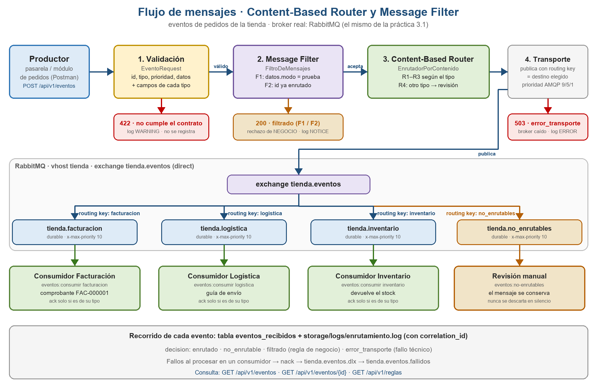

# Práctica 3.2 – Patrones de enrutamiento y distribución lógica

**Estudiante:** Yeiker Lopez · IS-803 Integración e Implementación de Software · 8vo "A" · ULEAM
**Rama:** `practica-enrutamiento-yeiker-lopez` (trabajo individual dentro del proyecto de aula)

Proceso del proyecto de aula (tienda de 5 nodos): **eventos del ciclo de vida de un pedido**. La pasarela de pagos y el módulo de pedidos emiten eventos de distinto tipo. Si todos llegaran al mismo proceso, se facturarían cancelaciones o se devolvería stock de pedidos pagados. Para evitarlo hay dos piezas:
- un **Message Filter** que descarta lo que no debe procesarse;
- un **Content-Based Router** que envía cada evento **solo** al consumidor que le corresponde.

**Broker real:** se usa RabbitMQ, el mismo de la práctica 3.1 (no es una simulación). Cada consumidor es un proceso independiente que lee su propia cola.



## Tipos de evento y consumidores

| Tipo | Consumidor | Qué hace (verificable) |
|---|---|---|
| `pago_aprobado` | **Facturación** (`eventos:consumir facturacion`) | Emite el comprobante `FAC-000001` del pedido (tabla `comprobantes`) |
| `pedido_despachado` | **Logística** (`eventos:consumir logistica`) | Registra la guía de envío y el transportista (tabla `envios`) |
| `pedido_cancelado` | **Inventario** (`eventos:consumir inventario`) | Devuelve al stock las unidades del pedido (`productos.stock` y `movimientos_inventario`) |
| cualquier otro | **Revisión manual** (`eventos:no-enrutables`) | El mensaje se conserva en la cola `tienda.no_enrutables` |

Cada consumidor procesa **solo sus tipos**. Si por error le llegara otro, lo rechaza a la cola de fallidos sin tocar datos. Además es idempotente: no emite dos comprobantes, ni dos guías, ni devuelve el stock dos veces para el mismo pedido.

## Contrato del mensaje

```json
{
  "id": 5001,
  "tipo": "pago_aprobado",
  "prioridad": "alta",
  "datos": { "pedido_id": 1001, "monto": 45.90, "metodo": "tarjeta", "modo": "real" }
}
```

| Campo | Tipo | Obligatorio |
|---|---|---|
| `id` | entero JSON > 0 (identificador del evento) | sí |
| `tipo` | texto en minúsculas y `_` (3 a 40) | sí (puede ser desconocido) |
| `prioridad` | `alta` \| `normal` \| `baja` | sí |
| `datos` | objeto (puede ir vacío `{}`) | sí |
| `datos.pedido_id` | entero de un pedido existente | en los 3 tipos conocidos |
| `datos.monto` | número > 0, 2 decimales | en `pago_aprobado` |
| `datos.transportista` | texto | en `pedido_despachado` |
| `datos.motivo` | texto | en `pedido_cancelado` |
| `datos.modo` | `real` \| `prueba` | no (por defecto `real`) |

El identificador de correlación de la práctica 3.1 se usa igual: cabecera `X-Correlation-ID`. Si el cliente lo envía, se conserva; si no, se genera. Viaja dentro del mensaje (`correlation_id`) y aparece en cada línea del log y en el recorrido.

## Tabla de reglas

Orden: **validación → filtro → enrutador → cola**. `GET /api/v1/reglas` devuelve esta misma tabla desde el código.

| Regla | Condición | Resultado | Justificación |
|---|---|---|---|
| **F1** (filtro) | `datos.modo = "prueba"` | Rechazar (`200 filtrado`) | La pasarela envía eventos de su entorno de pruebas; procesarlos crearía comprobantes, envíos o devoluciones de stock que no existen |
| **F2** (filtro) | el mismo `id` ya fue enrutado | Rechazar (`200 filtrado`) | Un reintento del emisor no debe facturarse ni devolver stock dos veces |
| **R1** (enrutador) | `tipo = pago_aprobado` | `facturacion` → `tienda.facturacion` | Solo Facturación emite comprobantes |
| **R2** (enrutador) | `tipo = pedido_despachado` | `logistica` → `tienda.logistica` | Solo Logística registra guía y transportista |
| **R3** (enrutador) | `tipo = pedido_cancelado` | `inventario` → `tienda.inventario` | Una cancelación devuelve stock; no se factura ni se envía |
| **R4** (enrutador) | cualquier otro tipo | `no_enrutables` → `tienda.no_enrutables` | No se descarta en silencio: queda para que una persona decida |

La prioridad del evento se traduce en prioridad AMQP (alta 9, normal 5, baja 1). Si se acumulan mensajes, cada cola entrega primero los de prioridad alta.

## Topología en RabbitMQ (configurada de verdad)

| Elemento | Nombre | Detalle |
|---|---|---|
| Exchange | `tienda.eventos` | direct, durable |
| Routing keys → colas | `facturacion` → `tienda.facturacion` · `logistica` → `tienda.logistica` · `inventario` → `tienda.inventario` · `no_enrutables` → `tienda.no_enrutables` | colas durables, `x-max-priority: 10` |
| Fallos de procesamiento | `tienda.eventos.dlx` (fanout) → `tienda.eventos.fallidos` | `nack` sin reencolar de un consumidor |

El enrutador de Laravel **decide** la routing key; el broker solo entrega a la cola enlazada con esa clave.

## Rechazo de negocio frente a fallo de transporte

| Situación | HTTP | `decision` | Log |
|---|---|---|---|
| No cumple el contrato | 422 | (no se registra) | `WARNING validacion: …` |
| No cumple el filtro (F1/F2) | 200 | `filtrado` | `NOTICE filtro: rechazado por regla de negocio` |
| Tipo desconocido | 202 | `no_enrutable` | `INFO enrutador: R4 → no_enrutables` |
| Enrutado | 202 | `enrutado` | `INFO enrutador: R1 → facturacion` |
| Broker caído | 503 | `error_transporte` | `ERROR transporte: … (fallo técnico, NO rechazo de negocio)` |

## Requisitos

PHP 8.2 con `sockets` y `pdo_sqlite` (en XAMPP: `extension=sockets` en `php.ini`), Composer, Docker Desktop y Postman.

## Ejecución

```bash
# 1. Configuración (una sola vez)
composer install
cp .env.example .env        # RABBITMQ_USER y RABBITMQ_PASSWORD: los mismos valores de prueba de la práctica 3.1
php artisan key:generate
touch database/database.sqlite
php artisan migrate --seed  # productos y pedidos ficticios 1001 a 1004

# 2. Broker (el mismo de la 3.1): espere a que "docker compose ps" diga healthy
docker compose up -d
php artisan mensajeria:preparar   # crea exchange y colas, y muestra mensajes y consumidores de cada una

# 3. Una terminal para cada proceso
php artisan serve --host=127.0.0.1 --port=8000   # canal de entrada (API)
php artisan eventos:consumir facturacion
php artisan eventos:consumir logistica
php artisan eventos:consumir inventario
```

- Postman: importe [postman/Practica_Enrutamiento_Eventos.postman_collection.json](postman/Practica_Enrutamiento_Eventos.postman_collection.json) (10 peticiones con pruebas). Los `id` se generan solos en cada envío; el caso 5b reutiliza el del caso 1.
- Cola de revisión: `php artisan eventos:no-enrutables` (lista sin sacar los mensajes) o el panel http://localhost:15672 (pestaña Queues and Streams).
- Registro: `storage/logs/enrutamiento.log` · Recorrido: `GET /api/v1/eventos` y `GET /api/v1/eventos/{id}`.
- Para empezar de cero: detenga los consumidores y ejecute `php artisan migrate:fresh --seed`.
- Si el broker se reinicia, los consumidores avisan que perdieron la conexión: vuelva a iniciarlos.

## Casos obligatorios (resultados obtenidos)

| Caso | Entrada | Resultado |
|---|---|---|
| 1 | `pago_aprobado` (pedido 1001) | 202 R1 → solo Facturación: `Comprobante FAC-000001 emitido por $45.90` |
| 2 | `pedido_despachado` (pedido 1002) | 202 R2 → solo Logística: `Guía GUIA-1002-XXXX registrada con Servientrega` |
| 3 | `pedido_cancelado` (pedido 1003) | 202 R3 → solo Inventario: `Audífonos Bluetooth +1 (queda 16), Mouse inalámbrico +2 (queda 32)` |
| 4 | `devolucion_solicitada` | 202 R4 → cola `tienda.no_enrutables` (1 en espera, sin consumidor) |
| 5 | `pago_aprobado` con `modo: prueba` | 200 `filtrado` F1; Facturación no recibe nada. Reintento del caso 1: 200 `filtrado` F2 |
| 6 | sin `prioridad` ni `datos.monto` | 422 con el detalle de los dos campos |
| extra | broker apagado | 503 `error_transporte`, registrado como ERROR (no como filtrado) |

## Pruebas automáticas

```bash
php artisan test   # 25 pruebas: reglas (8), canal de entrada con los 6 casos (9), consumidores (5), RabbitMQ real (3)
```

Las de integración usan un exchange y colas propias (`*.pruebas`) y se omiten solas si el broker no está encendido. Comprueban:
- que cada tipo llega solo a su cola y que el filtrado no llega a ninguna;
- que con mensajes acumulados se entrega primero la prioridad alta;
- el flujo completo: API → broker → comando consumidor.

## Seguridad

El `.env` no se sube. `.env.example` solo trae los nombres de las variables, con usuario y clave vacíos. `mensajeria:preparar` nunca muestra la clave. Los datos son ficticios.
