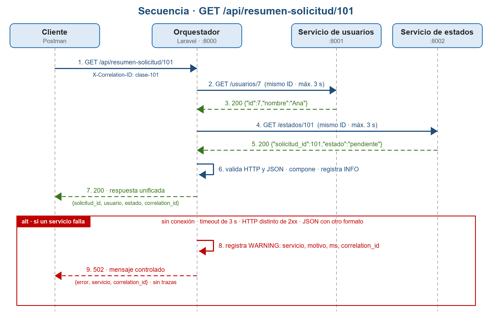

# Laboratorio de orquestación y composición de servicios

**Estudiante:** Yeiker Lopez · **Asignatura:** IS-803 Integración e Implementación de Software

Reproducción del laboratorio presentado por el Grupo 1, adaptada a nuestro entorno (Windows, PHP 8.2, Laravel 12). Un **orquestador** en Laravel recibe `GET /api/resumen-solicitud/101`, consulta dos **servicios HTTP independientes** (usuarios y estados), valida sus respuestas y **compone** una sola respuesta JSON. Si un servicio falla, responde `502` con un mensaje controlado y deja el detalle en un registro, siempre con el mismo `X-Correlation-ID`.

## Qué pide la práctica y dónde está

| # | Requisito | Dónde se cumple |
|---|---|---|
| 01 | `/usuarios/7` → `{"id":7,"nombre":"Ana"}` y `/estados/101` → `{"solicitud_id":101,"estado":"pendiente"}` | `servicios/usuarios.php` (puerto 8001) y `servicios/estados.php` (puerto 8002) |
| 02 | `GET /api/resumen-solicitud/101` consulta ambos con `Http::timeout(3)->get(...)` | `routes/api.php` → `ResumenSolicitudController` → `app/Services/OrquestadorSolicitudes.php` |
| 03 | Si un servicio falla: JSON controlado y `502`, sin trazas | `ResumenSolicitudController` (captura `DependenciaNoDisponible`) |
| 04 | Respuesta con `solicitud_id`, `usuario`, `estado` y `correlation_id`; generar o propagar `X-Correlation-ID` | `OrquestadorSolicitudes::resumen()` y `app/Http/Middleware/CorrelationId.php` |
| 05 | Flujo normal en Postman y servicio que no responde; comparar respuesta y registro | `postman/Laboratorio_Orquestacion.postman_collection.json` y `storage/logs/orquestacion.log` |
| 06 | Diagrama cliente → orquestador → usuarios / estados → respuesta | `docs/secuencia-orquestacion.png` |

## Archivos

| Archivo | Rol |
|---|---|
| `servicios/usuarios.php`, `servicios/estados.php` | Servicios de prueba, cada uno en su propio proceso PHP |
| `app/Http/Middleware/CorrelationId.php` | Genera o propaga `X-Correlation-ID`, lo agrega a cada línea del registro y lo devuelve en la cabecera |
| `app/Services/OrquestadorSolicitudes.php` | Orquestación: llama a cada servicio con espera de 3 s, valida código HTTP y contenido, y compone la respuesta |
| `app/Exceptions/DependenciaNoDisponible.php` | Describe qué servicio falló y por qué |
| `app/Http/Controllers/ResumenSolicitudController.php` | Responde `200` o `502` y escribe el registro |
| `config/orquestacion.php` | Direcciones de los servicios y tiempo de espera (desde `.env`) |
| `tests/Feature/ResumenSolicitudTest.php` | 9 pruebas automáticas con `Http::fake` |

## Preparación

Requisitos: PHP 8.2 o superior y Composer. No se necesita frontend.

```powershell
cd practica-orquestacion-yeiker-lopez
composer install
copy .env.example .env
php artisan key:generate
php -r "touch('database/database.sqlite');"
php artisan migrate
```

Las direcciones de los servicios están en `.env` (`ORQ_USUARIOS_URL`, `ORQ_ESTADOS_URL`, `ORQ_TIMEOUT=3`). Si cambias `.env`, ejecuta `php artisan config:clear`.

## Iniciar los tres procesos

Abre **tres terminales** en la carpeta `practica-orquestacion-yeiker-lopez` y déjalas abiertas:

```powershell
# Terminal 1 – servicio de usuarios
php -S 127.0.0.1:8001 servicios/usuarios.php

# Terminal 2 – servicio de estados
php -S 127.0.0.1:8002 servicios/estados.php

# Terminal 3 – orquestador (Laravel)
php artisan serve --host=127.0.0.1 --port=8000
```

## Demostración

Importa la colección de Postman o usa `curl.exe` en una cuarta terminal. En PowerShell escribe `curl.exe`, porque `curl` solo es otro nombre de `Invoke-WebRequest`.

**1. Flujo normal**

```powershell
curl.exe -i -H "X-Correlation-ID: clase-101" http://127.0.0.1:8000/api/resumen-solicitud/101
```

```json
{"solicitud_id":101,"usuario":{"id":7,"nombre":"Ana"},"estado":"pendiente","correlation_id":"clase-101"}
```

`clase-101` aparece en la cabecera de la respuesta, en las terminales 1 y 2 (`[usuarios] GET /usuarios/7 -> 200 | correlation_id=clase-101`) y en el registro. Sin la cabecera, Laravel genera un UUID.

**2. Un servicio que no responde**

1. En la terminal 2 presiona `Ctrl+C` para detener el servicio de estados.
2. Repite la petición: responde `502`.

```json
{"error":"No se pudo armar el resumen: el servicio de estados no está disponible.","servicio":"estados","correlation_id":"clase-101"}
```

3. Abre `storage/logs/orquestacion.log`: la última línea explica la falla.
4. Inicia de nuevo el servicio de estados y repite: vuelve a responder `200`.

**3. Otros fallos, sin modificar código** (con los tres procesos activos)

| Petición | Qué hace el servicio de estados | Respuesta del orquestador |
|---|---|---|
| `/api/resumen-solicitud/103` | Responde HTTP 500 | `502` |
| `/api/resumen-solicitud/104` | Responde 200 con otro formato (`{"request":104,"status":"pending"}`) | `502` |
| `/api/resumen-solicitud/999` | Responde 404 | `502` |
| `/api/resumen-solicitud/102` | Tarda 5 s | `502` a los 3 s (timeout) |

## Respuesta y registro: comparación (ejecución real)

El cliente recibe siempre el mismo mensaje controlado. El motivo técnico solo queda en el registro, unido a la respuesta por el `correlation_id`:

```text
[2026-11-18 19:06:59] local.INFO: Orquestación completada {"solicitud_id":101,"ms":{"usuarios":67,"estados":5}} {"correlation_id":"clase-101"}
[2026-11-18 19:07:01] local.WARNING: Falla de orquestación {"solicitud_id":103,"servicio":"estados","motivo":"respondió HTTP 500","url":"http://127.0.0.1:8002/estados/103","ms":4} {"correlation_id":"clase-103"}
[2026-11-18 19:07:01] local.WARNING: Falla de orquestación {"solicitud_id":104,"servicio":"estados","motivo":"contenido inválido","url":"http://127.0.0.1:8002/estados/104","ms":4} {"correlation_id":"clase-104"}
[2026-11-18 19:07:06] local.WARNING: Falla de orquestación {"solicitud_id":102,"servicio":"estados","motivo":"sin respuesta en 3 s (timeout)","url":"http://127.0.0.1:8002/estados/102","ms":3010} {"correlation_id":"clase-102"}
[2026-11-18 19:07:23] local.WARNING: Falla de orquestación {"solicitud_id":101,"servicio":"estados","motivo":"sin conexión","url":"http://127.0.0.1:8002/estados/101","ms":2019} {"correlation_id":"clase-101"}
```

| | Respuesta al cliente | Registro (`orquestacion.log`) |
|---|---|---|
| Para quién | Cliente (Postman, frontend) | Equipo que diagnostica |
| Código | `200` o `502` | `INFO` o `WARNING` |
| Contenido | Resumen, o mensaje genérico con el servicio que falló | Servicio, motivo exacto, URL interna y milisegundos |
| Trazas o direcciones internas | Nunca | Sí (URL), para diagnosticar |
| Une ambos | `correlation_id` | `correlation_id` |

## Diagrama de secuencia



## Pruebas automatizadas

```powershell
php artisan test
```

9 pruebas con `Http::fake`, sin servidores:

- composición y propagación del ID;
- ID generado cuando no llega y ID inválido reemplazado;
- error HTTP, servicio caído, timeout y contenido inválido → `502`;
- si falla usuarios, ya no se consulta estados;
- solo se aceptan identificadores numéricos.

## Diferencias con el ejemplo del Grupo 1

| Ejemplo del Grupo 1 | Esta versión | Motivo |
|---|---|---|
| PHP 8.4 y Laravel 13 | PHP 8.2 y Laravel 12 | El ejemplo no arranca con PHP 8.2 (`Composer detected issues in your platform`) |
| Toda la lógica en una función dentro de `routes/api.php` | Middleware + servicio + controlador | Cada responsabilidad en su lugar; el orquestador se prueba y reutiliza aparte |
| `correlation_id` armado a mano en la ruta | Middleware `CorrelationId` + `Context` | Se aplica a toda la API y aparece solo en cada línea del registro |
| Fallas en `laravel.log`, solo con el tipo de excepción | `orquestacion.log` con éxitos y fallas: servicio, motivo, URL y ms | Comparar respuesta y registro es más claro |
| `502` con `"Dependencia no disponible"` | `502` que además dice qué servicio falló | Más útil para el cliente, sin exponer detalles internos |
| La lentitud se prueba agregando `sleep(5)` al código | Escenarios 102, 103 y 104 ya incluidos | Se demuestra cada falla sin editar archivos |
| `estado` devuelto como el objeto del servicio | `estado` como texto (`"pendiente"`) | Composición real: no se repite `solicitud_id` |

Problema encontrado en Windows: con PHP 8.2, el servidor integrado (`php -S`) **queda colgado** si el cliente corta la conexión mientras el script está en `sleep()`. Eso pasa justo en el timeout. Se resolvió con `ignore_user_abort(true)` en el escenario lento (`servicios/estados.php`).

## Relación con el proyecto de aula

En la tienda de 5 nodos, el backend (L3) ya hace algo parecido en `GET /api/health`: consulta la base de datos (L4) y el servidor de archivos (L5) y compone un solo estado, `degraded` si alguno falla. Este laboratorio aplica el mismo patrón con llamadas HTTP reales, límite de espera, validación del contenido y un identificador de correlación que permite seguir una operación a través de todos los servicios.

## Diagnóstico

- `404` en `/api/resumen-solicitud/101`: revisa que `bootstrap/app.php` registre `routes/api.php`.
- `502` inesperado: prueba cada servicio directamente (`curl.exe http://127.0.0.1:8001/usuarios/7`) y revisa `storage/logs/orquestacion.log`.
- Puerto ocupado: usa otro y actualiza `ORQ_USUARIOS_URL` o `ORQ_ESTADOS_URL` en `.env`; luego `php artisan config:clear`.
