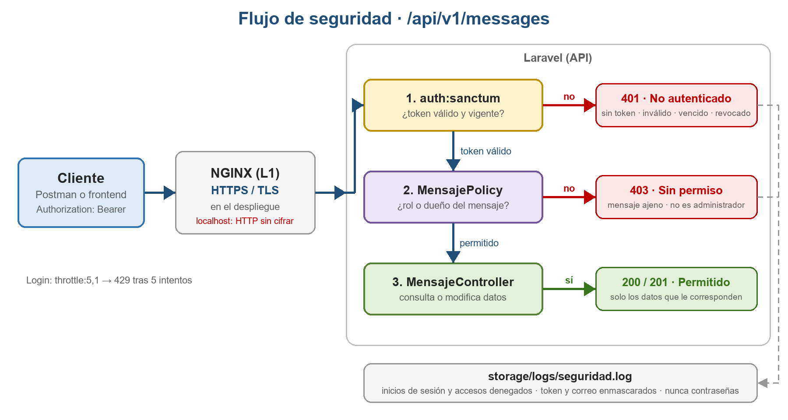

# Práctica 2.4 – Seguridad de la información en tránsito

**Estudiante:** Yeiker Lopez · **Asignatura:** IS-803 Integración e Implementación de Software · **Tema 2.4**

Módulo individual del proyecto de aula (tienda de 5 nodos). Protege los **mensajes de clientes a la tienda**, el mismo recurso del backend del proyecto (`POST /messages`, `GET /messages/my`, `GET /messages`) y de la pantalla *Mensajes* del frontend:

- **Autenticación** con Laravel Sanctum (token Bearer, equivalente al JWT del proyecto).
- **Autorización** por rol (`customer` / `admin`) y por propietario, con una *policy*.
- **Secretos** en variables de entorno y un registro de seguridad que nunca guarda contraseñas ni tokens completos.

## Qué pide la guía y dónde está

| Guía | Dónde |
|---|---|
| Act. 1 – Endpoints, roles y matriz de acceso | [Matriz de acceso](#matriz-de-acceso) |
| Act. 2 – Credenciales en variables de entorno, `.env` excluido, HTTPS/TLS | [Variables de entorno](#variables-de-entorno) y [HTTPS/TLS](#httpstls) |
| Act. 3 – Autenticación, middleware, autorización, no registrar secretos | `routes/api.php`, `app/Policies/MensajePolicy.php`, `bootstrap/app.php`, `app/Support/Enmascarar.php` |
| Act. 4 – Pruebas P1 a P4 | Colección de Postman y `tests/Feature/SeguridadMensajesTest.php` (15 pruebas) |

## Matriz de acceso

| Endpoint | Método | Público | Cliente (`customer`) | Administrador (`admin`) |
|---|---|---|---|---|
| `/api/v1/auth/login` | POST | Sí (máx. 5 intentos por minuto) | Sí | Sí |
| `/api/v1/messages` | GET | No → 401 | Sí, **solo los propios** | Sí, todos |
| `/api/v1/messages/{id}` | GET | No → 401 | Solo si es propio; ajeno → 403 | Sí |
| `/api/v1/messages` | POST | No → 401 | Sí; el autor es siempre el dueño del token | Sí |
| `/api/v1/messages/{id}` | DELETE | No → 401 | No → 403 (aunque sea propio) | Sí |
| `/api/v1/auth/logout` | POST | No → 401 | Sí (revoca su token) | Sí |

Primero se comprueba **quién es** (autenticación, `auth:sanctum` → 401) y después **qué puede hacer** (autorización, `MensajePolicy` → 403).



## Archivos

| Archivo | Rol |
|---|---|
| `routes/api.php` | `auth:sanctum` en las rutas protegidas y `throttle:5,1` en el login |
| `app/Http/Controllers/Api/AuthController.php` | Login (emite el token) y logout (lo revoca) |
| `app/Http/Controllers/Api/MensajeController.php` | Lista, consulta, crea y elimina mensajes |
| `app/Policies/MensajePolicy.php` | Autorización por rol y propietario (403 con motivo) |
| `app/Models/User.php`, `app/Models/Mensaje.php` | `role` y `user_id` no se pueden asignar desde el JSON |
| `bootstrap/app.php` | Respuestas 401, 403 y 429 en JSON, y su registro; proxies de confianza para HTTPS |
| `app/Support/Enmascarar.php` | Oculta tokens y correos antes de registrarlos |
| `config/sanctum.php` | Solo tokens (sin sesiones) y vencimiento desde `.env` |
| `database/seeders/DatabaseSeeder.php` | Usuarios ficticios; las contraseñas salen del `.env` |

## Variables de entorno

Solo los nombres y ejemplos ficticios. Los valores reales viven en `.env`, que **no** está en el repositorio:

| Variable | Para qué | Ejemplo ficticio |
|---|---|---|
| `APP_KEY` | Clave de cifrado de Laravel (`php artisan key:generate`) | se genera en cada equipo |
| `APP_ENV` | `local` o `production`; en producción se fuerzan URL `https://` | `production` |
| `APP_DEBUG` | `true` solo en desarrollo; en producción `false`, para no mostrar trazas | `false` |
| `APP_URL` | Dirección pública de la API | `https://tienda.example` |
| `DB_CONNECTION`, `DB_DATABASE` | Base de datos | `sqlite` |
| `SANCTUM_EXPIRATION` | Minutos de validez de cada token | `120` |
| `SANCTUM_TOKEN_PREFIX` | Prefijo de los tokens, para reconocerlos si se filtran | `tienda_` |
| `TRUSTED_PROXIES` | IP de NGINX (L1), el único proxy en el que se confía | `192.168.10.11` |
| `SEED_ADMIN_PASSWORD`, `SEED_CLIENTE_PASSWORD` | Contraseñas de los usuarios de prueba | definir en el `.env` local |

Comprobaciones (P4):

```powershell
git check-ignore -v .env                 # .gitignore:3:.env → .env está excluido
git ls-files | Select-String "\.env"     # solo aparece .env.example
```

En el código no hay contraseñas ni claves. Si faltan las contraseñas de prueba en `.env`, el seeder se detiene con `Define SEED_ADMIN_PASSWORD y SEED_CLIENTE_PASSWORD en tu .env…`. Además, Sanctum guarda en la base de datos solo el **hash SHA-256** de cada token, no el token.

## HTTPS/TLS

**En este laboratorio (`http://127.0.0.1:8000`) no hay TLS: el tráfico, incluido el token, viaja sin cifrar.** Solo es aceptable en el propio equipo.

En el despliegue del proyecto, el cifrado se haría en NGINX (L1), el único punto de entrada:

```nginx
server {
    listen 80;
    return 301 https://$host$request_uri;              # todo HTTP se redirige a HTTPS
}
server {
    listen 443 ssl;
    ssl_certificate     /etc/ssl/tienda/fullchain.pem;  # certificado (p. ej. Let's Encrypt)
    ssl_certificate_key /etc/ssl/tienda/privkey.pem;    # la clave privada solo existe en el servidor
    ssl_protocols TLSv1.2 TLSv1.3;
    add_header Strict-Transport-Security "max-age=31536000" always;

    location /api/ {
        proxy_pass http://<IP de L3>:3001;              # red interna del proyecto
        proxy_set_header X-Forwarded-Proto $scheme;
        proxy_set_header X-Forwarded-For $proxy_add_x_forwarded_for;
    }
}
```

Del lado de Laravel ya está preparado:
- `trustProxies` (en `bootstrap/app.php`, con `TRUSTED_PROXIES`) confía solo en NGINX, para saber que la petición original llegó por HTTPS;
- con `APP_ENV=production`, `URL::forceHttps()` hace que todas las URL generadas usen `https://`.

## Cómo ejecutarlo

Requisitos: PHP 8.2 o superior con `pdo_sqlite`, y Composer.

```powershell
cd practica-seguridad-yeiker-lopez
composer install
copy .env.example .env
php artisan key:generate
# Escribe en .env tus contraseñas de prueba: SEED_ADMIN_PASSWORD y SEED_CLIENTE_PASSWORD
php -r "touch('database/database.sqlite');"
php artisan migrate:fresh --seed
php artisan serve
```

Usuarios ficticios: `admin@tienda.test` (admin), `ana@tienda.test` y `luis@tienda.test` (clientes). Ana tiene los mensajes 1 y 2, y Luis el 3.

## Pruebas

**Postman:** importa `postman/Practica_Seguridad_Mensajes.postman_collection.json`. En las variables de la colección escribe `clave_admin` y `clave_cliente` como *Current value*: así no quedan en el archivo. Ejecuta los tres login y luego P1, P2, P3 y los extras. Los tokens se guardan solos en variables, por lo que **nunca aparecen en las capturas** (salvo en la respuesta del login: no la captures).

**Automáticas:** `php artisan test` → 15 pruebas.

Resultados con el servidor real:

| Caso | Petición | Código | Motivo |
|---|---|---|---|
| P1 | Ana `GET /messages` | 200 | Solo sus 2 mensajes |
| P1 | Admin `GET /messages` | 200 | Los 3 mensajes |
| P1 | Ana `POST /messages` con `"user_id": 3` | 201 | El autor sigue siendo Ana |
| P1 | Admin `DELETE /messages/3` | 200 | Mensaje eliminado |
| P2 | `GET /messages` sin token | 401 | No autenticado |
| P2 | Token inventado | 401 | No autenticado |
| P2 | Token de Luis después de su logout | 401 | Token revocado |
| P3 | Luis `GET /messages/1` (de Ana) | 403 | No puedes ver mensajes de otros clientes |
| P3 | Ana `DELETE /messages/1` | 403 | Solo un administrador puede eliminar mensajes |
| — | Login con contraseña incorrecta | 401 | Credenciales inválidas (no revela si la cuenta existe) |

Registro de seguridad (`storage/logs/seguridad.log`), con tokens y correos enmascarados:

```text
[2026-11-18 22:30:50] local.INFO: Inicio de sesión {"usuario_id":2,"rol":"customer","token_id":1}
[2026-11-18 22:30:56] local.WARNING: Acceso denegado (401) {"metodo":"GET","ruta":"api/v1/messages","ip":"127.0.0.1","token":"5|toke…ante"}
[2026-11-18 22:30:56] local.WARNING: Acceso denegado (403) {"usuario_id":3,"metodo":"GET","ruta":"api/v1/messages/1","motivo":"No puedes ver mensajes de otros clientes."}
[2026-11-18 22:30:59] local.WARNING: Inicio de sesión fallido {"email":"an***@tienda.test","ip":"127.0.0.1"}
```
