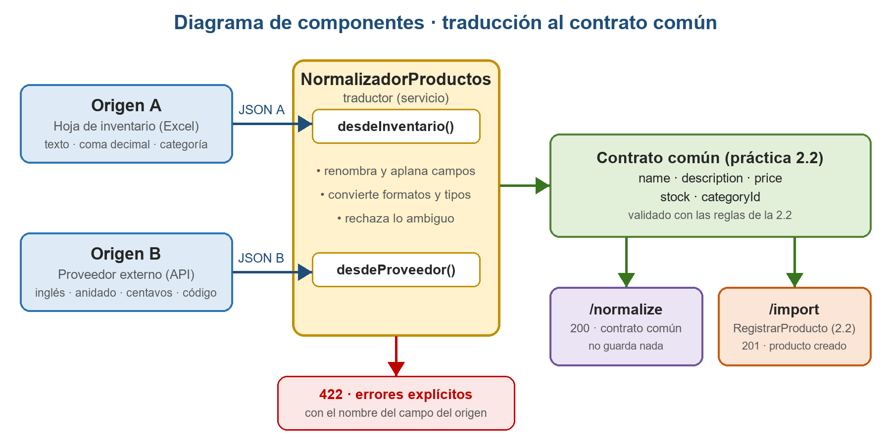

# Traducción y normalización de productos

**Estudiante:** Yeiker Lopez · **Asignatura:** IS-803 Integración e Implementación de Software · **Tema 2.3**

## 1. Conflicto estructural (Actividad 1)

En el proyecto de aula, los productos del catálogo pueden llegar desde dos componentes que representan el mismo dato de forma distinta:

| | Origen A | Origen B |
|---|---|---|
| Componente | Hoja de inventario exportada de Excel (carga masiva del administrador) | API de un proveedor mayorista (simulada) |
| Endpoint | `POST /api/v1/normalize/inventory` · `POST /api/v1/import/inventory` | `POST /api/v1/normalize/supplier` · `POST /api/v1/import/supplier` |

**Origen A:**
```json
{
  "nombre_producto": "Parlante portátil",
  "descripcion": "Resistente al agua, 12 h de batería",
  "precio": "35,50",
  "existencias": "20",
  "categoria": "Electrónica"
}
```

**Origen B:**
```json
{
  "product": {
    "title": "Parlante portátil",
    "details": "Resistente al agua, 12 h de batería",
    "pricing": { "amount_cents": 3550, "currency": "USD" },
    "inventory": { "available": 20 },
    "category_code": "ELEC"
  }
}
```

**Contrato común** (el de la práctica 2.2, ver [CONTRATO.md](CONTRATO.md); no se modifica):
```json
{
  "name": "Parlante portátil",
  "description": "Resistente al agua, 12 h de batería",
  "price": 35.5,
  "stock": 20,
  "categoryId": 1
}
```

**Diferencias entre los orígenes:**

1. **Nombres de campos:** español con guion bajo (`nombre_producto`, `existencias`) en A; inglés (`title`, `available`) en B.
2. **Estructura:** A es plana; B anida los datos dentro de `product`, `pricing` e `inventory`.
3. **Formato del precio:** A usa texto con coma decimal (`"35,50"`); B usa centavos enteros con moneda (`3550`, `"USD"`).
4. **Tipos:** A envía todo como texto (`"20"`); B usa números (`20`).
5. **Referencia a la categoría:** A la escribe por nombre (`"Electrónica"`); B usa un código propio (`"ELEC"`).
6. **Campos opcionales:** A deja la descripción vacía (`""`); B simplemente omite `details`.

## 2. Tabla de mapeo (Actividad 2)

| Origen A | Origen B | Contrato común | Regla |
|---|---|---|---|
| `nombre_producto` | `product.title` | `name` | Renombrar y sacar del anidamiento; quitar espacios; obligatorio |
| `descripcion` (`""` si no hay) | `product.details` (puede faltar) | `description` | Texto vacío o campo ausente → `null` |
| `precio` `"35,50"` (texto) | `product.pricing.amount_cents` `3550` + `currency` `"USD"` | `price` `35.5` (número, USD) | A: exigir `^\d+(,\d{1,2})?$` y cambiar la coma por punto. B: exigir entero > 0 y moneda USD, y dividir entre 100 |
| `existencias` `"20"` (texto) | `product.inventory.available` `20` | `stock` `20` (entero) | A: exigir solo dígitos y convertir a entero. B: exigir entero ≥ 0 |
| `categoria` `"Electrónica"` | `product.category_code` `"ELEC"` | `categoryId` `1` | A: buscar por nombre sin distinguir mayúsculas. B: tabla de equivalencias `ELEC`→Electrónica, `HOME`→Hogar, `ACC`→Accesorios |

## 3. Entradas que se rechazan (en lugar de convertirlas en silencio)

| Entrada | Origen | Por qué se rechaza | Error (422) |
|---|---|---|---|
| `"precio": "35.50"` | A | Ambiguo: esa hoja usa coma decimal; podría ser un error de formato | `precio: "35.50" es ambiguo: esta hoja usa coma decimal. Escriba "35,50".` |
| `"precio": "1.234,50"`, `"35,555"`, `"treinta"` | A | Separador de miles, 3 decimales o texto | `precio: "…" no es un monto válido: use solo dígitos y coma decimal …` |
| `"existencias": "20.5"` o `"veinte"` | A | Una cantidad no puede tener decimales ni letras | `existencias: "…" no es una cantidad válida …` |
| `"categoria": "Juguetes"` | A | No existe en el catálogo | `categoria: la categoría "Juguetes" no existe. Valores válidos: Accesorios, Electrónica, Hogar.` |
| `"currency": "EUR"` | B | El traductor no inventa conversiones de moneda | `product.pricing.currency: "EUR" no se acepta: solo precios en USD …` |
| `"amount_cents": "3550"` o `35.5` | B | Debe ser un entero de centavos | `product.pricing.amount_cents: debe ser un número entero de centavos …` |
| Falta `product.pricing` | B | Campo obligatorio | Errores en `product.pricing.amount_cents` y `product.pricing.currency` |
| `"category_code": "TOYS"` | B | Código sin equivalencia | `product.category_code: código desconocido: "TOYS". Valores válidos: ELEC, HOME, ACC.` |

Cada error se guarda bajo **el nombre del campo del origen** y su mensaje empieza con ese nombre (`precio: …`, `product.pricing.currency: …`), para que quien envía los datos sepa exactamente qué corregir. Se reúnen todos los errores de una entrada en una sola respuesta. Después de traducir, el contrato se valida con las reglas de la 2.2; por ejemplo, un nombre repetido devuelve `422` en el campo `name`.

## 4. Traductor (Actividad 3)

`app/Services/NormalizadorProductos.php` es una clase independiente de los controladores:

- `desdeInventario(array $entrada): array` traduce el origen A.
- `desdeProveedor(array $entrada): array` traduce el origen B.
- Ambos devuelven el mismo arreglo `{ name, description, price, stock, categoryId }` o lanzan una `ValidationException` (422) con los errores de cada campo.

`ImportacionController` no conoce los formatos de origen. Pide el contrato al traductor, lo valida con las reglas de `RegistrarProductoRequest` (2.2) y, en `/import`, lo registra con el mismo servicio `RegistrarProducto` de la 2.2.

## 5. Interoperabilidad (Actividad 4)

Las entradas A y B de la sección 1 producen **exactamente** el mismo contrato: mismos valores, mismos tipos (`35.5` número, `20` entero) y mismo orden de campos. Lo comprueban la prueba automática `test_p2_el_origen_b_equivalente_produce_el_mismo_contrato_y_tipos` (con `assertSame`), la prueba P2 de Postman y la página `traductor.html`.

**Por qué la traducción está en un servicio y no en los controladores:**

- Las reglas de cada origen están en **un solo lugar**. Si el proveedor cambia su formato, se cambia un método, no varios controladores.
- El traductor se puede **probar sin HTTP** (ver `NormalizadorProductosTest`) y **reutilizar** desde cualquier parte: un controlador, un comando de importación o una tarea programada.
- Agregar un origen C es agregar un método. El contrato común y los controladores no cambian.
- El controlador queda delgado y no depende de cómo llama cada origen a sus campos.

## 6. Pruebas

| Caso | Entrada | Resultado |
|---|---|---|
| P1 | Origen A válido → `POST /normalize/inventory` | `200` con el contrato común |
| P2 | Origen B equivalente → `POST /normalize/supplier` | `200` con el mismo contrato que P1, idéntico en valores y tipos |
| P3 | `"precio": "35.50"` en A, o falta `pricing` en B → `POST /import/...` | `422` con el error explícito de cada campo; no se guarda nada |
| Extra | Importar A | `201` con la respuesta de la 2.2 |
| Extra | Importar el mismo producto desde B | `422` "Ya existe un producto con ese nombre." (regla de la 2.2) |

## 7. Diagrama de componentes


